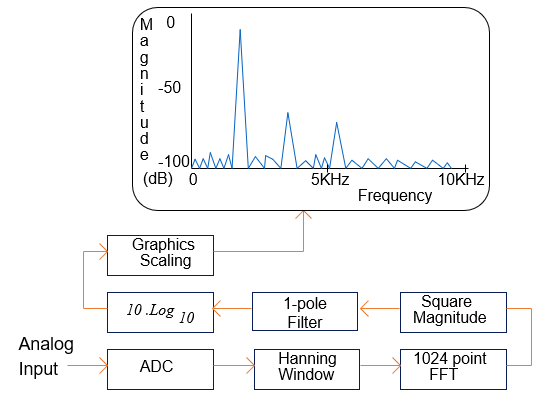

# Fourier Transform Based Spectrum Analyzer Simulation

This program provides a complete simulation of an end to end spectrum analyzer and includes the following functionality:

 - Sampling rate 44.1 kHz

 - Variable FFT frame length (default = 1024 samples)

 - Generate a sine wave with variable amplitude (default = 1V) and frequency (default = 1 kHz)

 - N (default = 8) bit Analog to Digital Converter (ADC) with a hard limit at Full Scale Deflection (FSD)

 - Window (default = Hann)

 - FFT

 - Square magnitude

 - One-pole filter with normalized gain of 1 (default alpha = 0.9)

 - dB conversion with 0dBFS = Full Scale Deflection of the Analog to Digital Converter

 - Scaling / plotting

The default input voltage (1V) of the sine wave maps to the FSD of the ADC and the FFT output is scaled
so that FSD into the ADC equals 0 dBFS (dB Full Scale) in the graph.

I.E. for the default values: -1V maps to -128 and +1V maps to +127.

The core code for the simulation can be found in the function update_data_and_plots().

## Dependencies

This application requires the following Python packages to be installed:

 - numpy

 - scipy

 - sys

 - PyQt6

 - pyqtgraph

This software is supplied under the terms of the MIT license: https://opensource.org/license/mit/
(C) 2026 Delta Numerix
